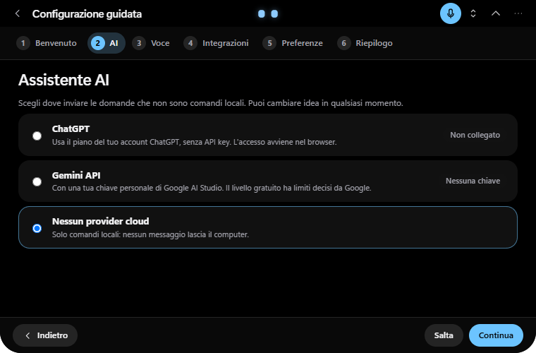
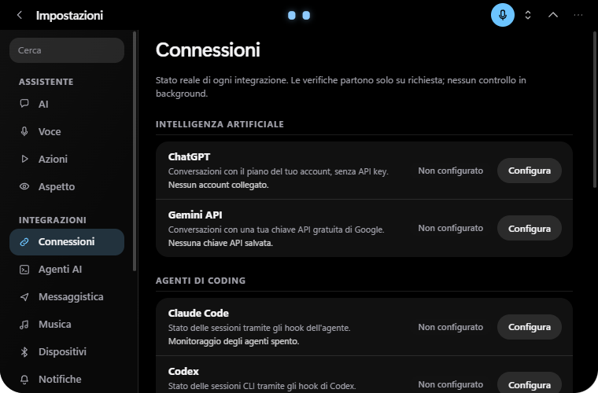
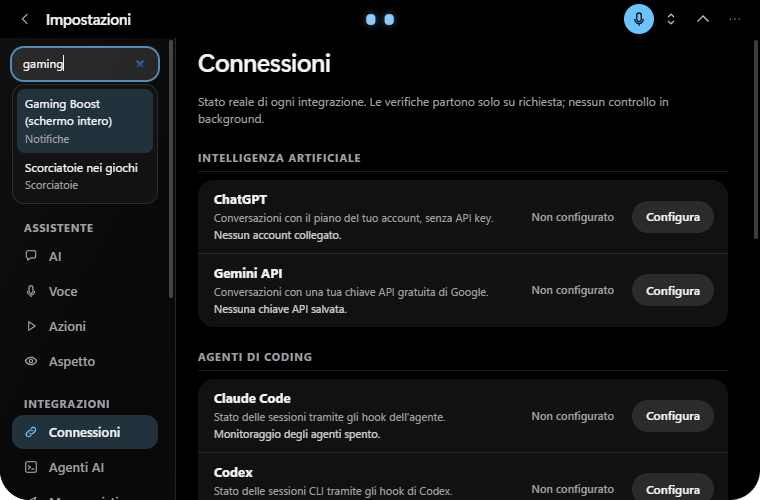
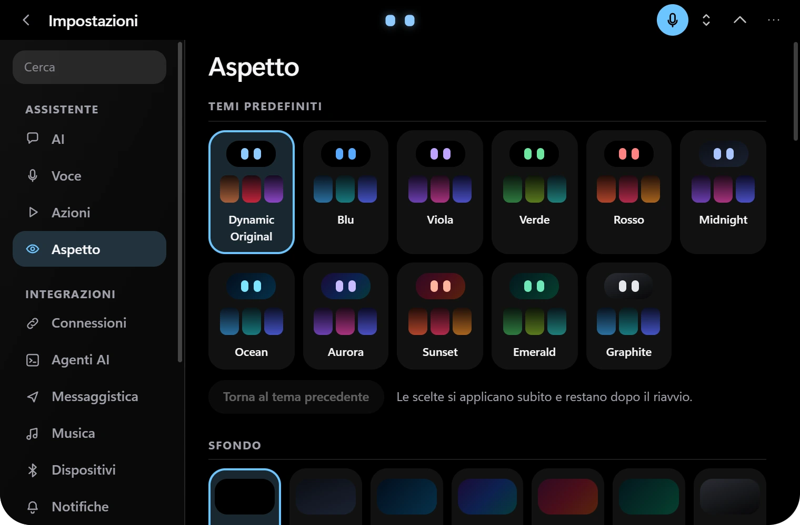
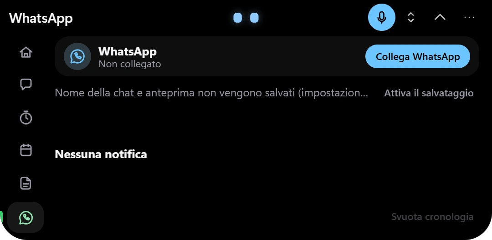
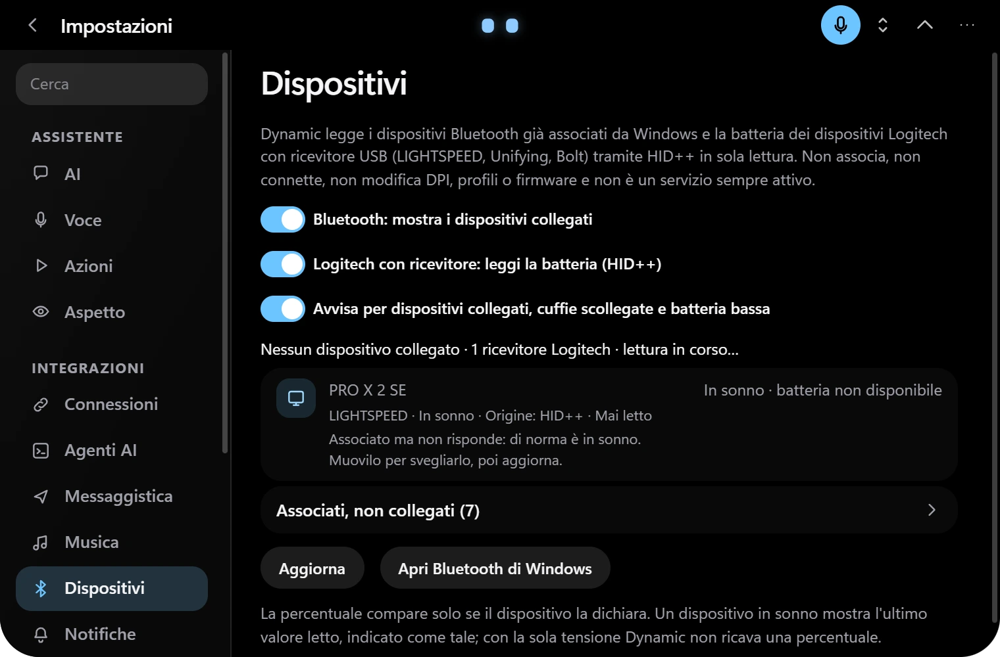
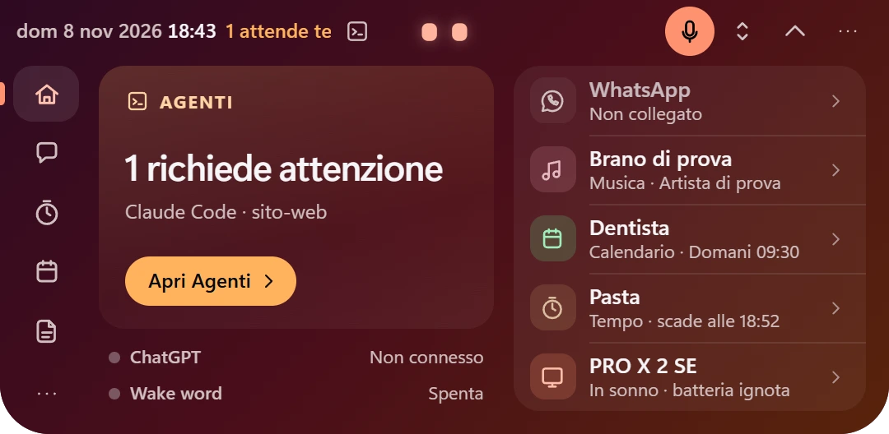
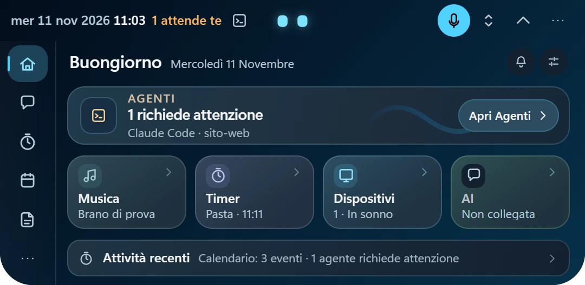
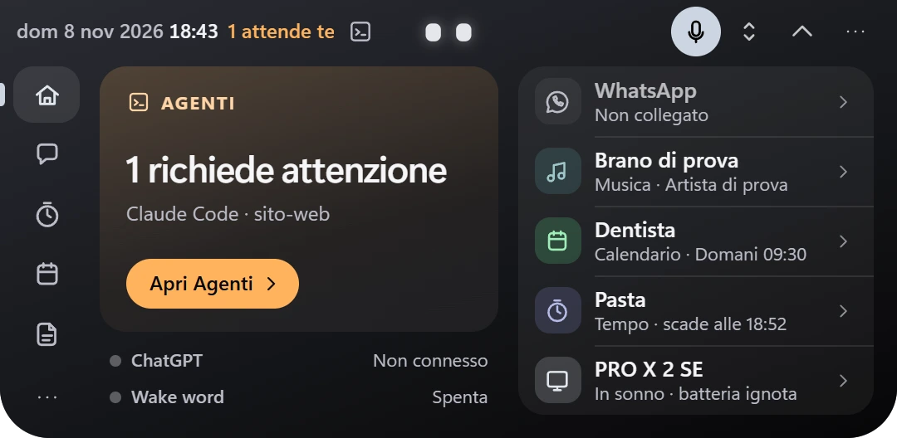

<h1 align="center">Dynamic</h1>

  <strong>Smart Desktop Assistant for Windows 11.</strong> 
  A compact Dynamic Island for AI, local voice commands, notifications, music, devices, notes, time and coding agents.

  

  
  
  
  
  

  <a href="https://github.com/andrea4546/Dynamic-releases/releases/latest"><b>⬇️ Download for Windows</b></a> ·
  <a href="#whats-new-in-020">What's new</a> ·
  <a href="#screenshots">Screenshots</a> ·
  <a href="#features">Features</a> ·
  <a href="#privacy-and-security">Privacy</a> ·
  <a href="#known-limitations">Known limitations</a>

  

> Dynamic is a personal Windows project. This repository hosts the public installers and update feed; the source repository is private.
> The app interface and voice are in Italian. The installer is not Authenticode-signed, so Windows SmartScreen may warn on first run.

## What Dynamic is

Dynamic stays at the top of the desktop as a small, low-distraction pill and expands only when needed. It combines an AI chat with local,
deterministic actions: timers, reminders, notes, calendar, media controls and navigation work without giving the AI permission to operate the PC.
Speech recognition and synthesis run locally on the CPU; only conversational text is sent to the provider selected by the user.

The V6.1 Refined interface uses static theme surfaces and event-driven Windows integrations. It does not capture the screen, inject into other
processes or run speech inference on the GPU.

## What's new in 0.2.0

- **Guided setup** for AI, voice, integrations and preferences. It can be postponed, resumed and reopened; older profiles are migrated without forcing the wizard.
- **Connections** shows the real state and next action for ChatGPT, Gemini, coding agents, messaging, music and calendar, with diagnostics designed not to expose secrets.
- **Offline Settings search**, keyboard navigation included.
- **Cleaner public build**: the former local demo provider is removed and the internal test bench is hidden.
- **Auto-hide reliability**: clicks made while the island is sliding back into view are no longer lost in the reproduced case.
- **Whole-app UI review** across every section, Settings page and all eleven themes, including contrast, empty states, spacing and accessible names.
- **Contextual setup links** from voice errors, such as configuring the microphone or connecting an AI provider.

Existing settings, accounts, notes, timers, conversations, shortcuts and voice models are designed to survive the update from 0.1.13.

## Screenshots

Every image below is a capture of the **real native app** (Tauri + WebView2) from the 0.2.0 release candidate. Captures use a throw-away
profile and invented data; no personal account, conversation, calendar address, credential or private path is shown.

| | |
|---|---|
|  **Guided setup** — choose ChatGPT, a personal Gemini key or local commands only |  **Connections** — real state, explanation and next action for every integration |
|  **Settings search** — local, keyboard-driven and linked to the exact option |  **Appearance** — eleven themes and the approved Dynamic identity |
|  **Chat and local actions** — commands still work with no cloud AI connected |  **Confirmation** — sensitive operations wait for an explicit yes or no |
|  **Calendar** — read-only ICS agenda and expanded month view |  **Time** — timers, alarms and reminders from one page |
|  **Music** — Windows media sessions, transport, timeline and per-player volume |  **Messaging** — isolated WhatsApp/Telegram Web connections and local notification history |
|  **Coding agents** — Claude Code and Codex sessions, observation only |  **Devices** — Windows Bluetooth and supported Logitech receivers |
|  **Notes** — local, searchable and autosaved |  **Notifications** — Dynamic events appear directly in the compact island |

  

### Four compact styles

Choose the shape in **Settings → Appearance**. The avatar, activities, notifications and expanded panel remain shared.

| Premium | Capsule | Indicator | Adaptive |
|---|---|---|---|
|  |  |  |  |
| 188 × 48 | 148 × 40 | 116 × 34 | 104 / 140 / 178 × 40 |

  
  
  

## Features

- **AI assistant** — ChatGPT through *Sign in with ChatGPT* when the account plan permits it, or Gemini through the user's own Google AI Studio key. There is no automatic paid-API fallback.
- **Local voice** — Whisper Base/Small and optional Parakeet Ultra for speech-to-text; Piper for Italian speech synthesis. Voice models run offline on the CPU.
- **Local actions** — deterministic commands for timers, reminders, notes, calendar, music and navigation. AI replies are never interpreted as commands; sensitive actions require confirmation.
- **Music** — controls Windows media sessions and can open Spotify, Apple Music or TIDAL using the Windows app catalogue or an explicit executable path.
- **Calendar** — read-only Google/Outlook ICS feeds, recurring events, time zones, reminders and offline encrypted cache. Creating or editing an event opens the browser.
- **Messaging** — WhatsApp Web and Telegram Web run in isolated WebView2 profiles. Dynamic can display their web notifications and keep an optional DPAPI-encrypted local history.
- **Coding agents** — optional, observation-only monitoring for Claude Code and Codex through local hooks. Prompt and tool contents are discarded. Codex hooks require explicit approval through `/hooks`.
- **Devices** — paired Bluetooth devices and supported Logitech LIGHTSPEED, Unifying and Bolt receivers, using read-only Windows/HID data.
- **Personalisation** — four compact styles, three avatars, eleven themes, docking/floating modes, multi-monitor placement and configurable shortcuts.
- **Fullscreen awareness** — can hide while a fullscreen app occupies the same monitor; no overlay injection or screen capture.
- **Self-updating** — manual install confirmation, minisign verification and preservation of the user profile.

## Installation

1. Open the [latest release](https://github.com/andrea4546/Dynamic-releases/releases/latest).
2. Download **`Dynamic_x.y.z_x64-setup.exe`** (roughly 600 MB because the offline speech models and WebView2 runtime are included).
3. Run the installer. It installs for the current user and does not require administrator rights.
4. Follow the guided setup, or postpone it and use local features first.

## Updates

Dynamic checks this repository's `latest.json` shortly after startup and then periodically when automatic checks are enabled. If a newer version
is available, Settings → Information shows it. Installation starts only after the user chooses it; the app downloads the installer, verifies its
minisign signature against the embedded public key, performs the per-user update and restarts. Settings and local data are retained.

## Requirements

- Windows 11 x64. Windows 10 is not tested.
- A CPU with AVX2; local speech recognition is CPU-only.
- A microphone for voice features.
- Internet only for the selected AI provider, calendar downloads, updates and the optional Parakeet download.
- For conversational AI: a compatible ChatGPT account or a personal Gemini API key. Local commands work without either.

## Privacy and security

| Data | Handling |
|---|---|
| Microphone audio | Processed locally and not written to disk. The optional wake word also runs locally. |
| Chat text | Sent only to the selected ChatGPT or Gemini provider, and only for messages that are not recognised local commands. |
| Credentials and calendar addresses | Stored with Windows DPAPI where sensitive; never placed in screenshots or diagnostics. |
| Notes, timers, conversations and histories | Kept in the user's local profile. |
| Screen and other applications | Dynamic does not capture the screen, inspect app contents or inject code. |
| Coding-agent hooks | Observation only; prompt and tool payloads are discarded. Dynamic never approves requests for the agent. |

Third-party licence notices, voice attribution and the corresponding Piper source references are included with the installer.

## Performance

Dynamic is designed to remain quiet while hidden or idle: Windows and media events are used where available, themes are static, and no GPU speech
inference or extra overlay process is used. A three-run 0.1.13 → 0.2.0 comparison found the same seven-process tree and CPU, memory, thread and handle
counts within short-sample noise. **FPS and frametime have not been measured in a real game.**

## Known limitations

- **Codex CLI notifications do not work in 0.2.0 on Windows.** With all seven Dynamic hooks approved through `/hooks`, a real Codex CLI 0.163.0 session still cannot launch the generated `commandWindows` (a quoting defect: the quoted executable path is rejected by Codex's `cmd /S /C` launch). Dynamic's local relay works when invoked directly; the fix needs a follow-up release. Claude Code monitoring is unaffected. The VS Code Codex extension is a separate, unverified path.
- Telegram notification reception has not been confirmed with a real account.
- Human-voice accuracy, wake-word false positives, suspend/hibernate, screen readers, real-game FPS/frametime and a clean second PC remain unverified.
- A multi-second Auto-hide stall seen once in an older build has not been reproduced; occasional visual glitches should not be described as definitively fixed.
- Apple Music and TIDAL have not been exercised with real accounts in the final candidate.
- The installer has a valid updater minisign signature but no Authenticode certificate; SmartScreen may warn.

## Release notes

See the [Releases](https://github.com/andrea4546/Dynamic-releases/releases) page for versioned notes and checksums.

---

Windows 11 x64 · Tauri 2 · Rust · React · TypeScript · whisper.cpp · Piper
