<h1 align="center">Dynamic</h1>

  <strong>A Dynamic Island for the Windows 11 desktop, with an animated robot, a voice-first AI assistant and a themeable interface.</strong> 
  Tauri 2 · Rust · React · TypeScript · local Whisper and Piper

  

  
  
  
  
  
  
  

  <a href="https://github.com/andrea4546/Dynamic-releases/releases/latest"><b>⬇️ Download for Windows</b></a> ·
  <a href="#screenshots">Screenshots</a> ·
  <a href="#features">Features</a> ·
  <a href="#updates">Updates</a> ·
  <a href="#privacy">Privacy</a>

  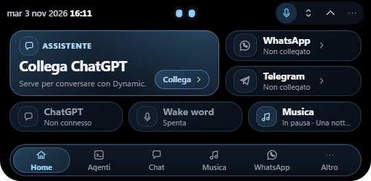

> Dynamic is a personal project for Windows. This page hosts the **installers** and the update feed; the source code is private.
> The app is in Italian (interface and voice). The installer is unsigned, so Windows SmartScreen may warn you the first time.

---

## Why

Most assistants live in a browser tab you have to go and find. Dynamic stays at the top edge of your screen, tiny until you need it, and
keeps the useful things one glance away: your AI chat, your agents, your messages, the song playing, a running timer. It talks and listens
**on your PC** (Whisper and Piper), and it never reads your screen or your other apps.

## What it is

Dynamic is a desktop assistant that lives in a small pill docked to the top edge of a monitor, like the iPhone's Dynamic Island.
It stays out of the way (a 188 × 48 px compact form) and expands into a panel, a chat or a settings view when you need it.
An animated avatar shows what the assistant is doing: idle, listening, thinking, using a tool, speaking, waiting for approval, done, error, new notification.
You pick the avatar in Settings: the original **eyes**, a little **robot**, or a **hitodama** (a floating spirit flame).

You can talk to it or type to it. Speech recognition (Whisper) and speech synthesis (Piper) run **locally on the CPU**; only the
text of your conversation is sent to ChatGPT, and only when you choose that provider.

## Screenshots

> The images below are the real Dynamic interface (the same React front-end, rendered by a Chromium engine) captured with
> **demonstration data and the browser simulator**, so they contain no personal account, conversation or file path. Replies
> shown in the chat and in the spoken-reply card are the simulator's labelled **DEMO** replies, *not* ChatGPT output.

| | |
|---|---|
|  **Home** — expanded panel; the bottom bar holds Home, *Altro* and four destinations you pin and reorder |  **Chat** — «Leggi risposte» and «Svuota contesto»; shown here with no AI connected |
|  **Listening** — the island widens and the avatar listens | 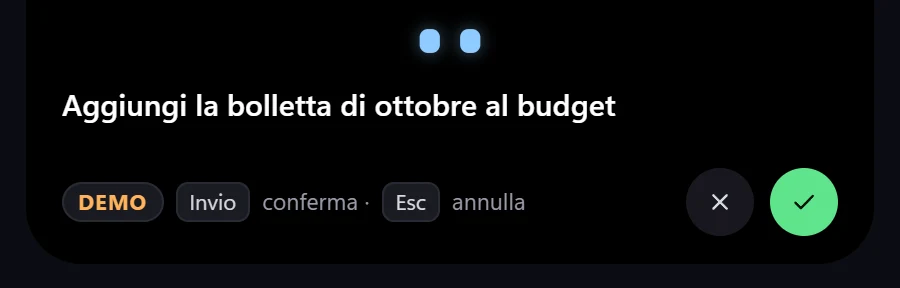 **Transcript review** — you confirm or correct what was heard before anything is sent |
| 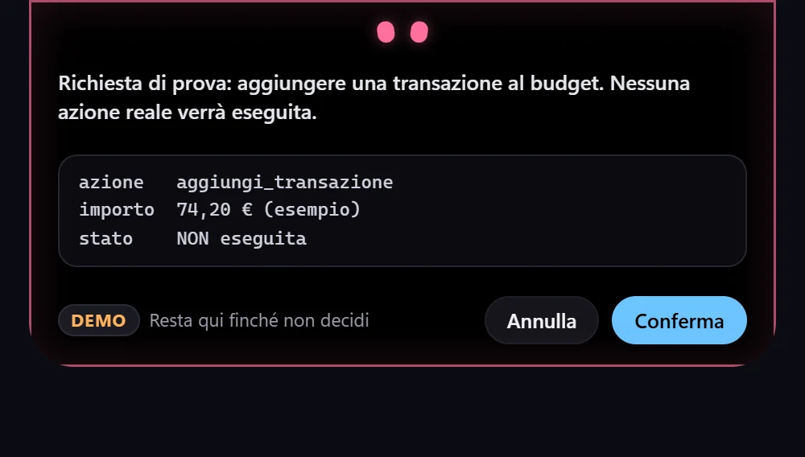 **Approval** — a request waits for your decision (the demo action is labelled and never executed) | 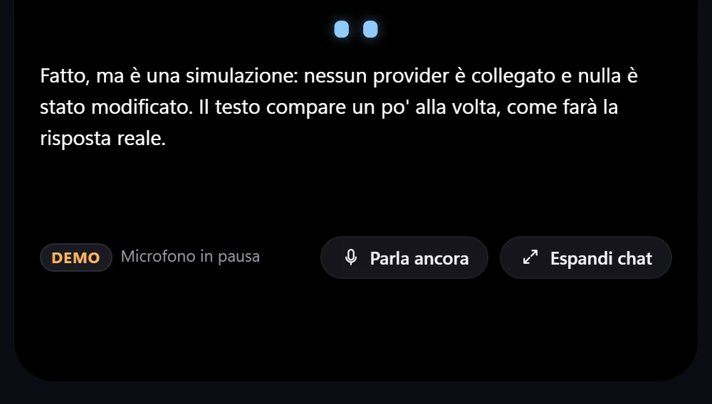 **Spoken reply** — text scrolls with the voice; Speak again / Expand chat |
| 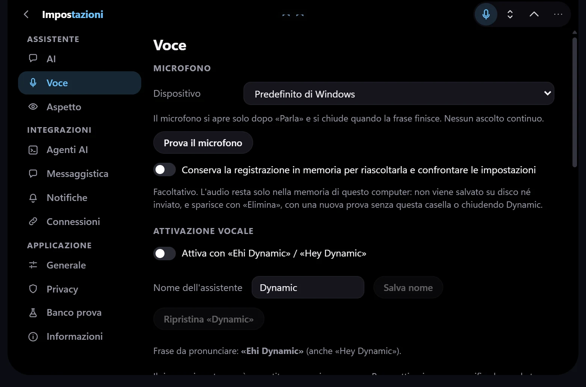 **Settings → Voice** — microphone, wake word (off by default), assistant name | 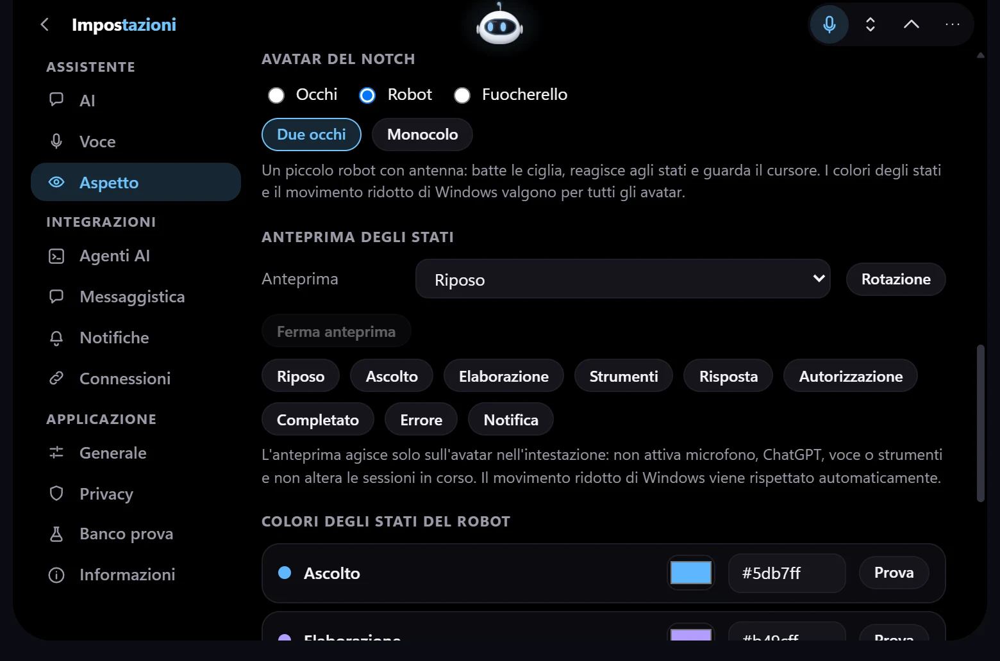 **Settings → Appearance** — avatar picker (eyes, robot, hitodama) and a preview of every state |

|  **Floating capsule** — detached from the edge: fully rounded, white outline | 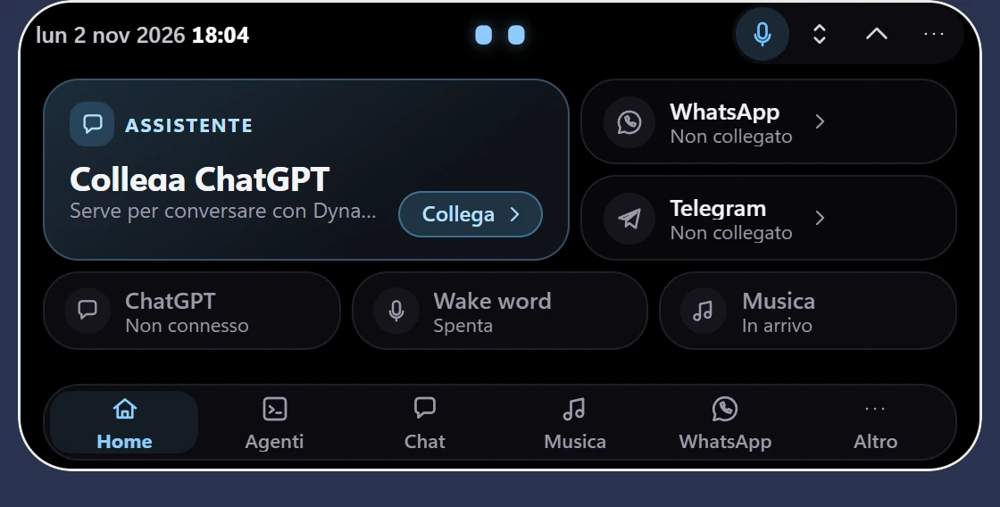 **Floating, expanded** — the panel opens below the capsule and keeps the outline |

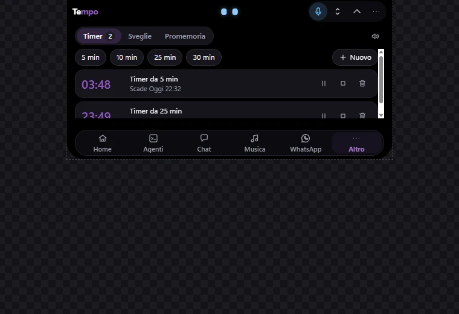

**Time** — timers, alarms and reminders in one area (Altro → Time); running timers count down locally, alerts use the internal notices

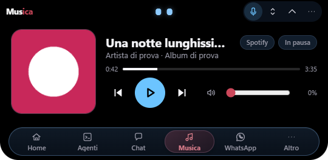

**Music** — GSMTC page with cover, timeline, transport and per-player volume. Native WebView2 capture; the player, cover and track are a **synthetic test session**, not a real Spotify account

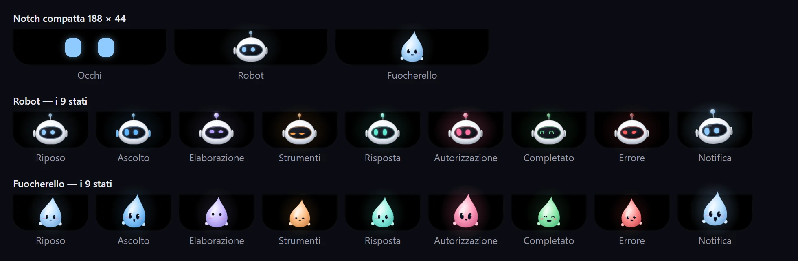

**Avatars** — the three avatars in the 188 × 48 px compact notch, then the robot and the hitodama in the nine states (idle, listening, thinking, tool, speaking, approval, done, error, notification). The state colour follows the theme.

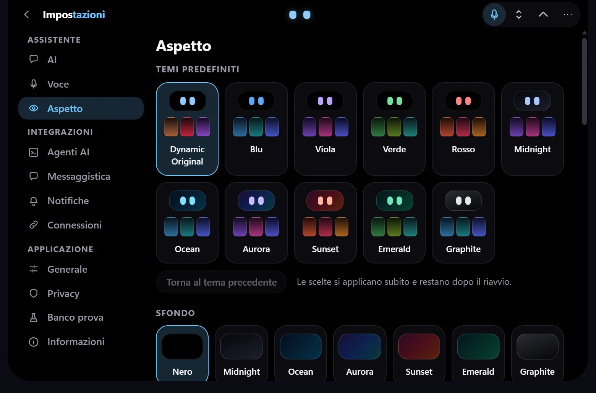

**Appearance** — eleven presets and seven backgrounds (black plus six static gradients), applied immediately, with *Torna al tema precedente*.

## Features

- 🏝️ **Dynamic Island on Windows** — a borderless, transparent window docked to the top edge, with rounded bottom corners and smooth shape morphing (compact, listening, transcript, reply, panel, chat, settings).
- 🤖 **Three avatars, nine states** — the original **eyes** (one engine, random blinking, glances that follow the cursor, six styles), a **robot** (white helmet, dark visor, antenna, ears) and a **hitodama** (a pale spirit flame with a face). Each is sized from the header height, so it fills the compact 188 × 48 notch, and each has its own expression for the nine states. The robot and the hitodama are hand-written HTML/CSS using only `transform` and `opacity` (no filters, no per-frame JavaScript); they stop when the window is hidden and honour `prefers-reduced-motion`. A state preview in Settings → Appearance shows them without touching the microphone or the chat.
- 🧭 **Customisable navigation** — the bottom bar keeps Home and *Altro* and lets you pin and reorder four more destinations (Agents, Chat, Music, WhatsApp, Telegram, Focus, Calendar, Clipboard, Notes). The choice is saved locally; *Altro* adapts to the window height and scrolls inside the compact panel.
- 🛰️ **AI agent monitoring (observation only, off by default)** — Claude Code and Codex sessions appear in an *Agents* section and as a badge on the compact island. A local relay receives hook events through a user-only named pipe; prompts, tool inputs and results are discarded. See the status table for what has been verified.
- 💬 **WhatsApp and Telegram notifications** — each service runs in its own isolated WebView2 window restricted to the official domains; web notifications become Dynamic notices and a local, DPAPI-encrypted history. No scraping and no unofficial API. Reception of WhatsApp notifications has been confirmed on the owner's PC; Telegram is **not** working yet (see the status table).
- 👁️ **Three visibility modes** — *Sempre* (always on top), *Auto* (slides away above the screen edge and reappears when the cursor touches the top-centre zone or an event needs you) and *No* (a normal window).
- 🪟 **Dock and undock** — drag the island down and it detaches from the top edge into a fully rounded **floating capsule** with a white outline (also when it expands); drag it back to the edge and it docks again, flat on top with no outline. Detaching and re-docking use two different distances (hysteresis) and are decided on release, so passing near the edge never flips it. A floating island is always visible and always on top, whatever *Sempre / Auto / No* is saved; docking it restores that saved mode. Position and mode survive a restart; the panel opens below the capsule and closes back to it. See `desktop/README.md`.
- 🖥️ **Magnetic docking and multi-monitor** — dropped anywhere, it glides back to the top edge of the monitor it was released on; handles negative coordinates and mixed DPI scales (verified at 100 % and 125 %).
- ✨ **Premium Design V4** — one visual system across Home, Agents, Chat, messaging history, Time, Music and Settings: dark-blue layered surfaces, thin borders, pill selection in the navigation bar, consistent compact/expanded density and honest empty states. The final WebView2 audit covers 15 native views, three themes, the tall panel and the floating capsule; the before/after evidence is in [`desktop/docs/redesign/`](desktop/docs/redesign/).
- 🎨 **Themes and gradients** — Dynamic Original plus Blu, Viola, Verde, Rosso, Midnight, Ocean, Aurora, Sunset, Emerald and Graphite; free eye/accent colours and per-state colours. Gradients are **static CSS** that follow the rounded shape: no background animation, no blur, no GPU load at rest. Contrast is checked by tests on every gradient point.
- 🎮 **Windows events and fullscreen awareness** — lock/unlock, sleep/resume, monitor and DPI changes and foreground-window changes arrive as native Windows notifications (no process injection, no screen capture, no GPU). While the session is locked or asleep the island is hidden; with **“Hide Dynamic when a fullscreen app occupies its monitor”** (Settings → Notifiche, on by default) it also hides in *Sempre*, *Auto* and *No* when the foreground window covers the island's monitor without a title bar and is not the Windows shell. A normal maximised window, or a fullscreen app on another monitor, does not count. Voice conversations and the tray *Show* command still bring it back for as long as needed.
- 🔔 **Island notifications** — internal Dynamic notices (monitor connected/disconnected, a test notice) shown on the compact island: one at a time, repeats merged (×N), a bounded queue and never over an open panel, chat or voice session. Lock and sleep clear them. In fullscreen Dynamic makes one non-activating presentation attempt; because Windows cannot reliably distinguish borderless from exclusive fullscreen by window geometry alone, the notice is retained and replayed for its full duration after leaving fullscreen. They are **not** Windows toasts and Dynamic does **not** read other applications' notifications.
- 🧠 **ChatGPT** — *Sign in with ChatGPT* (OAuth PKCE; tokens stay in the Rust backend, encrypted with Windows DPAPI), streaming answers with Stop, conversation context, no API key and no pay-per-use fallback. Verified natively with a real account on model `gpt-6.1-sol`.
- 🎙️ **Offline speech recognition** — whisper.cpp with the Silero VAD. **Quality** mode uses Whisper Small for conversations; **Fast** mode uses Whisper Base. Wake-word detection always uses Base.
- 🔊 **Offline speech synthesis** — Piper with the Italian *Serena (high)* voice in a separate process that is only started when needed.
- 🗣️ **Customisable wake word (experimental, off by default)** — say **«Ehi»/«Hey» + a name**. The name defaults to *Dynamic* and can be changed (e.g. *Jarvis*) in Settings → Voice without restarting; «Hey» is recognised as a variant of «Ehi». It is a local detector built from Silero + short Whisper Base transcriptions (not a trained keyword-spotting model), so it can miss or misfire. See [Project status](#project-status).
- 📖 **Read replies aloud** — in the typed chat, an on/off switch makes Piper read each answer sentence by sentence while it streams (Markdown symbols are not spoken), with *Interrompi lettura* separate from *Interrompi generazione*.
- 🗂️ **History and context** — conversations are stored locally, one file each, written atomically; the chat always starts empty at launch (earlier conversations stay archived and their context is never re-sent). **Svuota contesto** starts a clean conversation: nothing from the old one is sent to the model, the old one stays archived, and a late reply from it can never land in the new one.
- 📦 **All-in-one installer** — a single NSIS setup for the current user that bundles the app, WebView2, the models and the private Piper runtime. Nothing to install by hand.
- 🎵 **Music** — Windows media sessions (Spotify, browsers, other players): cover, timeline, transport and volume of the selected player only, plus a quiet indicator on the compact island. No account, no network.
- ⏱️ **Time** — timers, alarms and reminders in one area, driven by a native scheduler with no polling.
- 🔄 **Self-updating** — a red dot appears when a new version is published; one click in Settings downloads it, verifies its signature and installs it.

## Download

1. Open the [latest release](https://github.com/andrea4546/Dynamic-releases/releases/latest) and download **`Dynamic_x.y.z_x64-setup.exe`** (about 590 MB: it includes the speech models, so nothing is downloaded at install time).
2. Run it. It installs for your user only, **no administrator rights needed**.
3. Dynamic appears at the top of your screen. Click it to open the panel.

## Updates

Settings → Informazioni → *Aggiornamenti*. Dynamic checks `latest.json` in the public releases repository once shortly after start and then every few hours (a single HTTPS request to github.com, no personal data; switch it off with *Controlla gli aggiornamenti da solo*, or use *Controlla ora*). When a newer version exists a **red dot** appears on the menu / *Altro* / *Impostazioni* and on *Informazioni*. Nothing is installed by itself: *Aggiorna a x.y.z* downloads the full installer, **verifies its minisign signature** against the public key embedded in the app, runs it in passive per-user mode (no administrator rights) and Dynamic restarts. Settings, profiles and history are kept. The v0.1.0 installer has no updater: install v0.1.1 once by hand.

## Requirements

- Windows 11 x64 (built and tested on Windows 11 build 26200).
- An Internet connection **only** for ChatGPT. Speech recognition and synthesis work offline.
- A ChatGPT account whose plan permits the *Sign in with ChatGPT* usage; without it you can still use the voice features and the explicit DEMO provider.
- A microphone for voice features; a CPU with AVX2 (whisper.cpp is built with AVX2/FMA/F16C, no GPU is used).

Known limits: Italian is the only tuned language; Windows only; calendar, clipboard history and notes are not implemented.

## Privacy

| What | Where it goes |
|---|---|
| Microphone audio | Processed **locally**; never recorded to disk and never sent anywhere. The microphone opens only while you talk — or, if you switch the wake word on, it listens continuously **on this PC only** until you switch it off. |
| Your text | Sent to OpenAI **only** when the ChatGPT provider is selected and you send a message (the recent text of the current conversation). Nothing is sent with the DEMO provider. |
| Spoken wake phrase | Never sent: after a detection the transcript goes to a review step and is sent only when you confirm it. |
| Conversations and settings | Stored locally under `%APPDATA%\app.dynamic.island` (you can turn saving off). |
| ChatGPT tokens | Kept in the Rust backend, encrypted with DPAPI, never exposed to the interface or logged. |

The wake word is **disabled by default.**

---

Windows 10/11 x64 · Tauri 2 · Rust · React · TypeScript · whisper.cpp · Piper
