<h1 align="center">Dynamic</h1>

  <strong>A Dynamic Island for the Windows 11 desktop.</strong> 
  A tiny pill at the top of your screen that grows into your chat, calendar, notes, timers, music and coding agents — 
  and that you can simply talk to. Speech runs on your own PC.

  

  
  
  
  
  

  <a href="https://github.com/andrea4546/Dynamic-releases/releases/latest"><b>⬇️ Download for Windows</b></a> ·
  <a href="#a-look-inside">A look inside</a> ·
  <a href="#what-it-does">What it does</a> ·
  <a href="#updates">Updates</a> ·
  <a href="#privacy">Privacy</a> ·
  <a href="#honest-status">Honest status</a>

  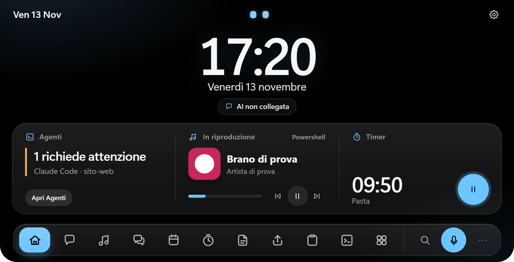

> Dynamic is a personal project for Windows. This page hosts the **installers** and the update feed; the source code is private.
> The app interface and voice are in Italian. The installer is not code-signed, so Windows SmartScreen may warn you the first time.

---

## Why

Most assistants live in a browser tab you have to go and find. Dynamic stays at the top edge of your screen, tiny until you need it, and keeps
the useful things one glance away: your chat, your agents, your calendar, the song playing, a running timer. It listens and speaks
**on your PC** (Whisper and Piper) and it never reads your screen or your other apps.

## A look inside

Every image is a capture of the **real app**, taken in a throw-away profile with invented data: no personal account, conversation or calendar appears.

| | |
|---|---|
| 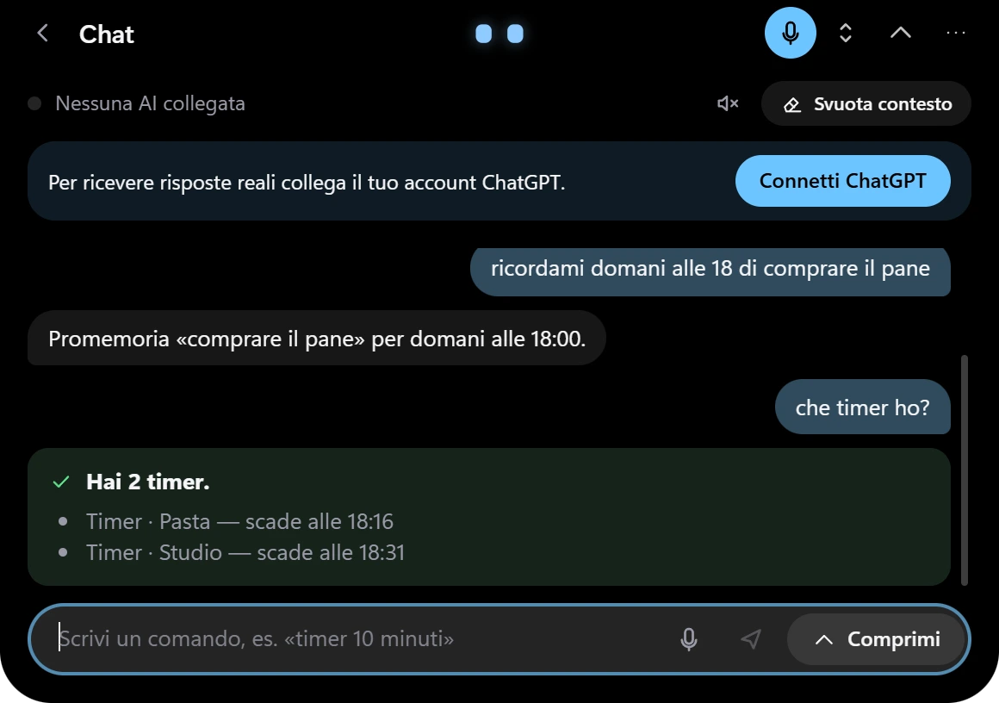 **Chat and actions** — «metti un timer», «ricordami domani alle 18…»: local commands answer with a result card | 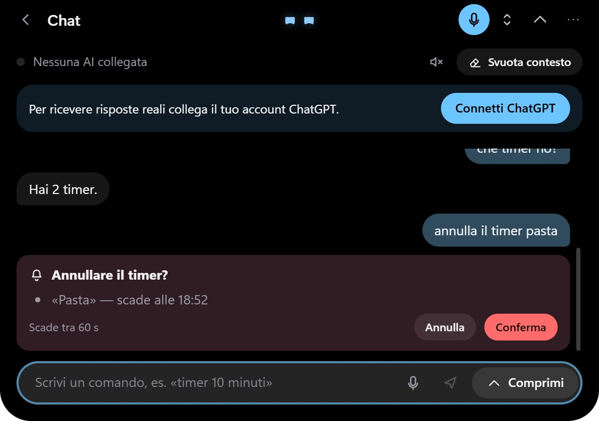 **Confirmation** — anything destructive shows a preview and waits for your yes or no |
| 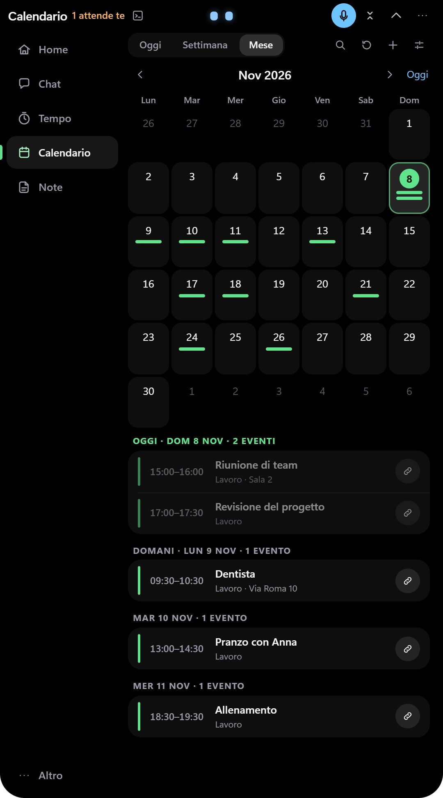 **Calendar** — expand the island and a full month grid appears, with the day's agenda below | 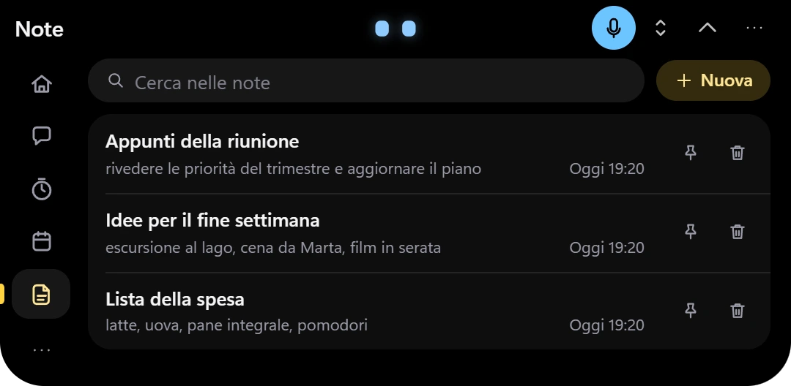 **Notes** — local, autosaved, searchable, pinnable |
| 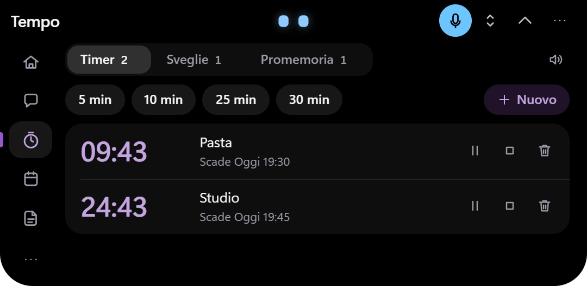 **Time** — timers, alarms and reminders in one place | 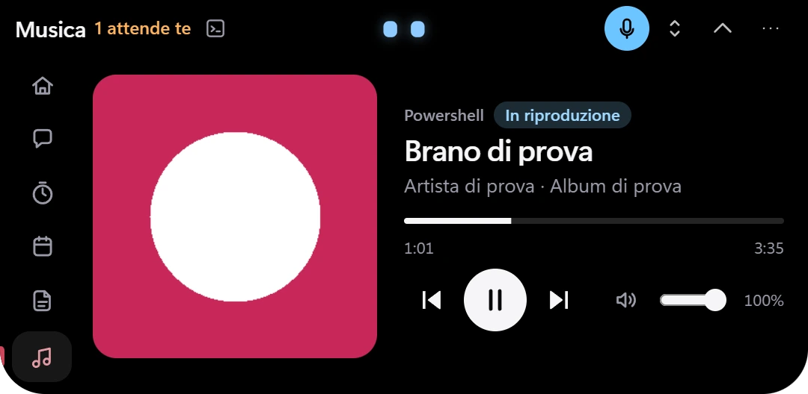 **Music** — cover, timeline, transport and volume of the player you pick *(a stand-in player here)* |
| 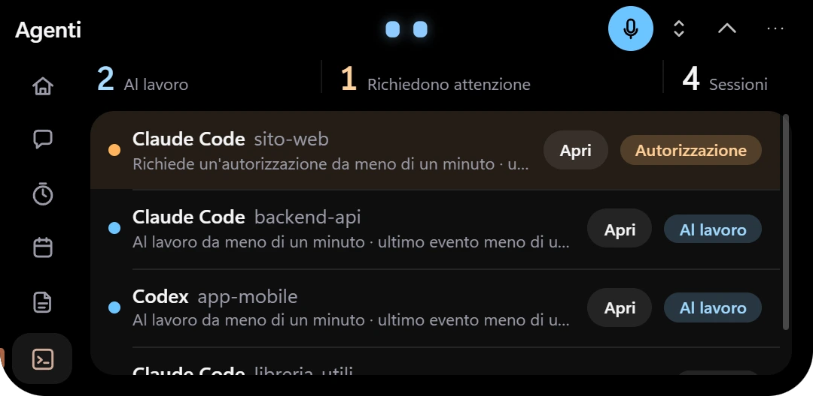 **Agents** — your Claude Code and Codex sessions at a glance; *Apri* brings the terminal to the front | 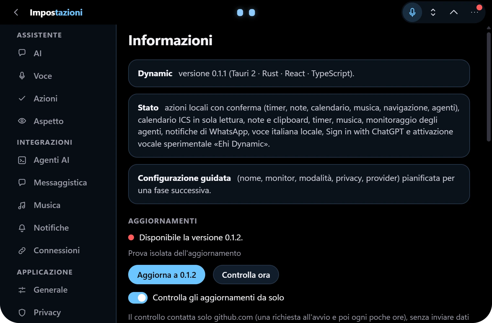 **Updates** — a red dot, one click, a verified signature |

  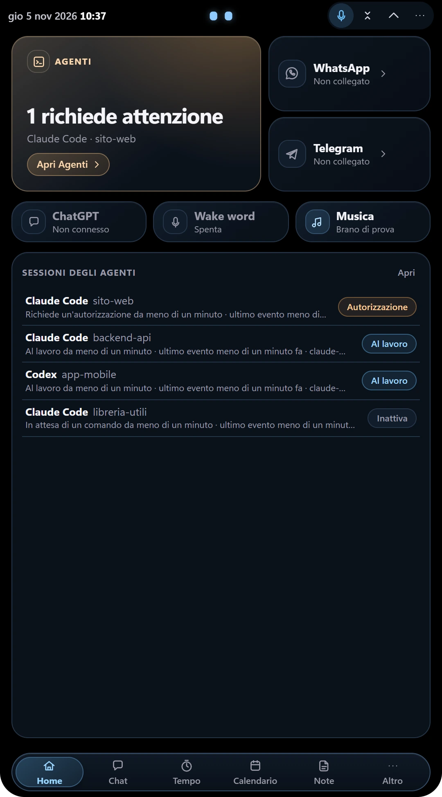
  &nbsp;&nbsp;
  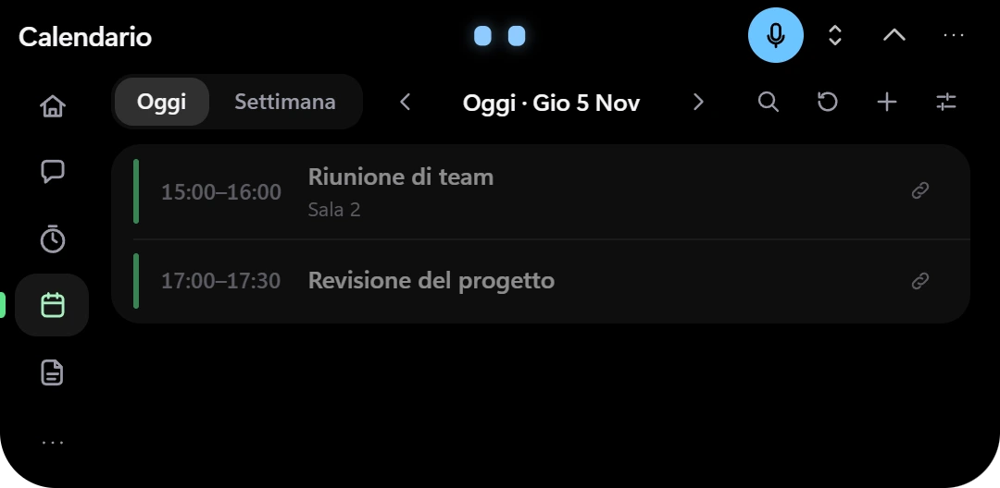

One button grows the island vertically · the same calendar as a compact agenda

## What it does

- 🏝️ **A real Dynamic Island** — a borderless pill docked to the top edge that morphs between compact, listening, chat, panel and settings. Drag it down and it detaches into a floating capsule; drag it back and it docks again. Three visibility modes, multi-monitor aware, and it steps aside when a fullscreen app takes the screen.
- 🤖 **Three avatars, nine states** — the original *eyes*, a little *robot* or a *hitodama* (a floating spirit flame) show whether it is idle, listening, thinking, speaking, waiting for you or done. Eleven themes and static gradients (no animated background, no GPU load at rest).
- ⚡ **Actions from chat or voice** — «metti un timer di 10 minuti», «ricordami domani alle 15 di chiamare Marco», «crea una nota: …», «che appuntamenti ho domani?», «pausa», «volume al 40», «apri il calendario», «com'è lo stato degli agenti?». Commands are understood by a **deterministic parser on your PC**, so the AI model can never trigger an action on its own, and your notes, calendar and timers are not sent to ChatGPT. Sensitive operations ask for confirmation first; per-category switches live in Settings → Azioni.
- 📅 **Calendar** — connect Google Calendar or Outlook with their private iCal address (read-only: no account access). Agenda for today and the week, a month grid when expanded, recurring events, time zones, reminders before events. Creating or editing an event opens your browser pre-filled.
- 📝 **Notes and clipboard history** — local notes with autosave and search; an opt-in clipboard history kept in memory only.
- ⏱️ **Timers, alarms, reminders** — driven by a native scheduler, no polling.
- 🎵 **Music** — controls whatever Windows is playing (Spotify, a browser, other players): cover, timeline, transport and per-player volume. No account, no network.
- 🛰️ **Coding-agent monitor** *(optional, off by default)* — see which Claude Code and Codex sessions are working, waiting for authorisation or done, and jump to the right terminal window. Observation only: prompts and tool contents are discarded.
- 💬 **WhatsApp Web** notifications in an isolated window with an encrypted local history. *(Telegram support exists but is not working yet.)*
- 🧠 **ChatGPT** — *Sign in with ChatGPT*, streaming answers, no API key and no pay-per-use fallback.
- 🎙️ **Local speech** — Whisper (speech-to-text) and Piper (Italian voice) run offline on the CPU. An experimental, off-by-default wake word: «Ehi» + a name you choose.
- 🔄 **Self-updating** — see below.

## Download

1. Open the [latest release](https://github.com/andrea4546/Dynamic-releases/releases/latest) and download **`Dynamic_x.y.z_x64-setup.exe`** (about 615 MB: it includes the speech models and the Windows WebView2 runtime, so nothing is downloaded at install time).
2. Run it. It installs for your user only — **no administrator rights needed**.
3. Dynamic appears at the top of your screen. Click it to open the panel.

## Updates

Dynamic checks this repository's `latest.json` shortly after it starts and then every few hours (one HTTPS request to github.com, no personal data;
you can switch it off in Settings → Informazioni). When a newer version exists a **red dot** appears; *Aggiorna a x.y.z* downloads the installer,
**verifies its minisign signature** against the public key built into the app, installs it for your user and restarts. Settings, timers, notes and history are kept.
The v0.1.0 installer has no updater: install v0.1.1 or later once by hand.

## Requirements

- Windows 11 x64 (developed and tested on Windows 11 build 26200; Windows 10 is not tested).
- A CPU with AVX2 (speech recognition runs on the CPU, no GPU is used).
- Internet only for ChatGPT, calendar feeds and updates; speech works offline.
- A microphone for voice; a ChatGPT account whose plan allows *Sign in with ChatGPT* for real chat answers.

## Privacy

| What | Where it goes |
|---|---|
| Microphone audio | Processed **locally**; never recorded to disk, never sent anywhere. It opens only while you talk (or, if you enable the wake word, listens on this PC only). |
| Your chat text | Sent to OpenAI **only** when you are signed in to ChatGPT and send a message. Action commands («timer», «nota», «calendario»…) stay on your PC. |
| Calendar address, notes, history, ChatGPT tokens | Stored on your PC, encrypted with Windows DPAPI where sensitive. Nothing is uploaded. |
| Other apps and your screen | Never read. |

## Honest status

What I have verified on my own PC: the installer, the local speech, ChatGPT sign-in, the island and its docking, notes, calendar (with synthetic and public feeds),
timers, music control with a test player, the agent monitor, WhatsApp notifications, and the update path 0.1.1 → 0.1.2 (in an isolated test product with the same updater and signing key).
What I have **not** verified: a clean second PC, a real Spotify / Google / Outlook account, spoken replies and wake-word accuracy in everyday noise, opening the browser for calendar events, a fullscreen game, a second monitor at other scaling, Telegram.
Expect rough edges — this is a one-person project.

---

Windows 11 x64 · built with Tauri 2, Rust, React and TypeScript · whisper.cpp · Piper
