<h1 align="center">Dynamic</h1>

  <strong>Smart Desktop Assistant for Windows 11.</strong> 
  A compact Dynamic Island for AI, local voice commands, music, calendar, notes, time, messages, file sharing and coding agents.

  

  
  
  
  
  

  <a href="https://github.com/JustKoal/Dynamic-releases/releases/latest"><b>⬇️ Download for Windows</b></a> ·
  <a href="#screenshots">Screenshots</a> ·
  <a href="#features">Features</a> ·
  <a href="#privacy-and-local-processing">Privacy</a> ·
  <a href="#installation-and-updates">Install</a> ·
  <a href="#known-limitations">Known limitations</a>

  

> Dynamic is a personal Windows project. This repository hosts the public installers and the update feed; the source repository is private.
> The «Source code» archives that GitHub attaches automatically to every release contain only this README and the screenshots, not the application code.
> The app interface and voice are in Italian. The installer is not Authenticode-signed, so Windows SmartScreen may warn on first run.

## What Dynamic is

Dynamic stays at the top of the desktop as a small, low-distraction pill and opens into a wide, low panel only when you need it. It combines an AI chat
with local, deterministic actions: timers, reminders, notes, calendar, media controls and navigation work without giving the AI permission to operate
the PC. Speech recognition and synthesis run locally on the CPU; only conversational text is sent to the AI provider you choose.

**Dynamic 0.3.0 introduces the V7 interface:** a wider and lower panel with an icon bar at the bottom, a clock-first Home with three widgets, a faster
two-step opening (width, then height), twelve themes including the new smoke-grey **Glass**, horizontal Settings and the new **Share file** feature.
Your profile from 0.2.x is kept: accounts, messages, preferences, themes, notes, calendar, reminders, voice settings, shortcuts and agents.

## Screenshots

All screenshots are taken from the native Windows build with a separate test profile and synthetic data (test media player, sample calendar, sample
agent sessions). No personal account, conversation or device appears.

| | |
|---|---|
|  **Home** — clock, status and three live widgets | 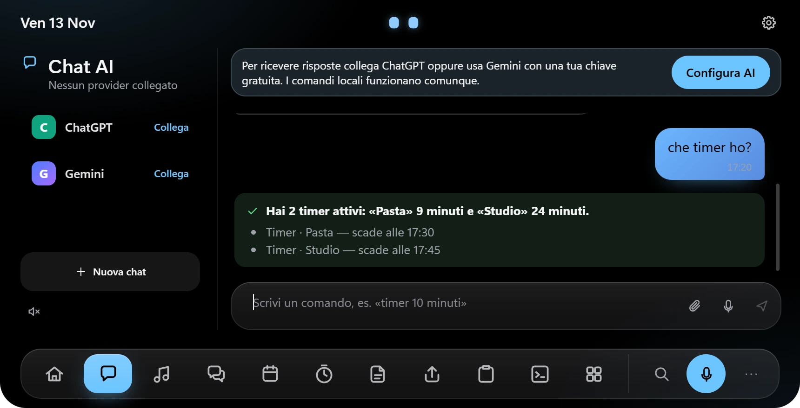 **Chat** — local commands answer even with no AI connected |
| 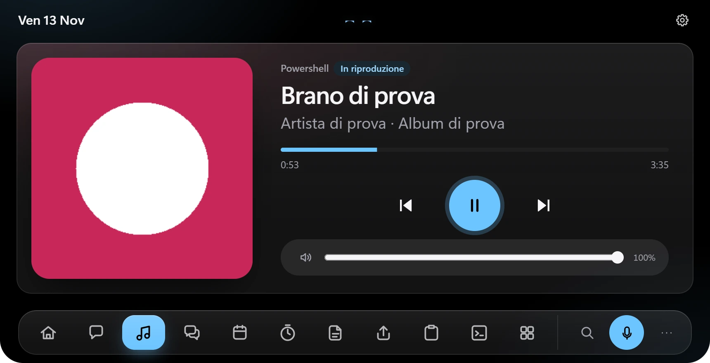 **Music** — Windows media sessions with cover, timeline and volume | 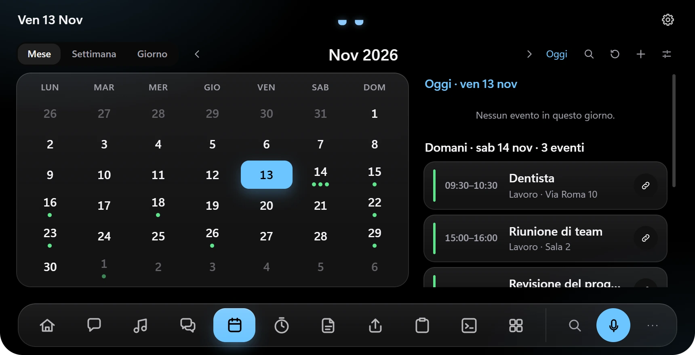 **Calendar** — read-only ICS feeds, month and agenda |
| 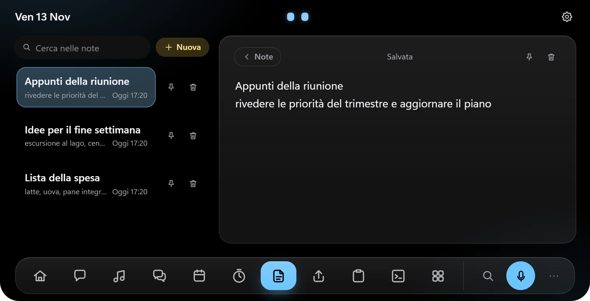 **Notes** — local, searchable, autosaved | 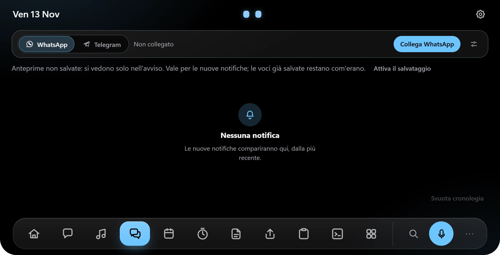 **Messages** — WhatsApp and Telegram in one place (shown not connected) |
| 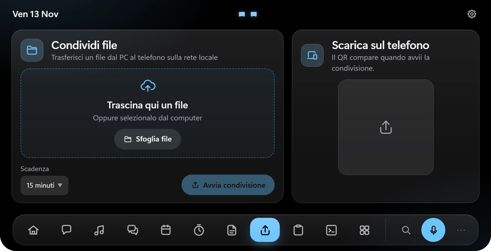 **Share file** — send a file from the PC to your phone on the local network with a QR code | 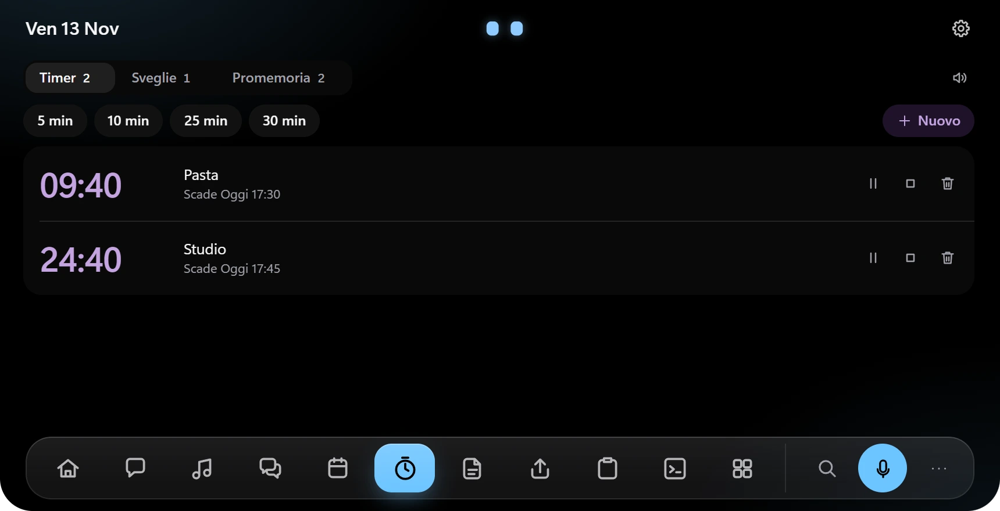 **Time** — timers, alarms and reminders |
| 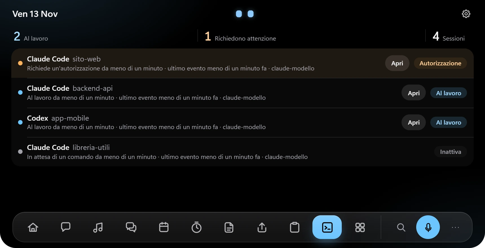 **Coding agents** — Claude Code and Codex sessions, observation only | 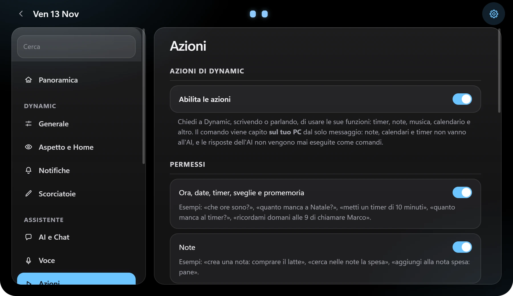 **Settings** — categories and search on the left, content on the right |
| 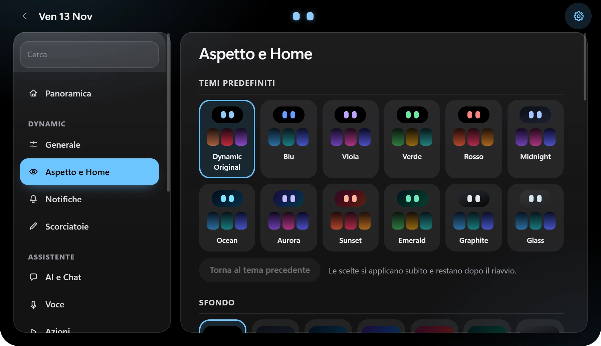 **Personalisation** — twelve themes, island shape and character |  **Notifications** — events appear directly in the compact island |

### Compact styles

| Premium | Capsule | Indicator |
|---|---|---|
|  |  |  |

A fourth style, **Adaptive**, changes width with the activities in progress.

### Themes

| | | |
|---|---|---|
| 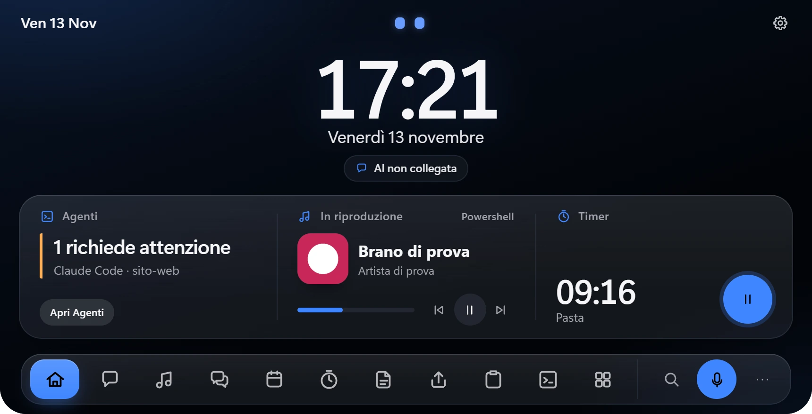 Blue | 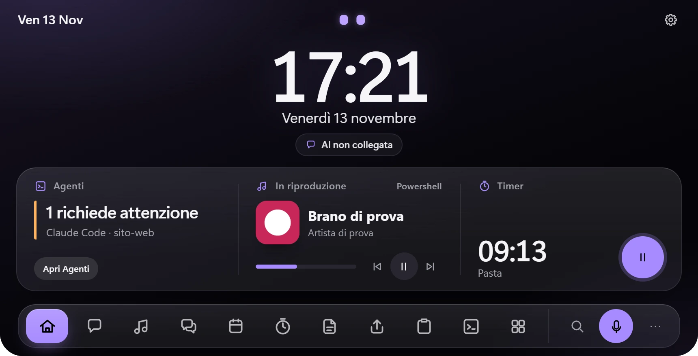 Violet | 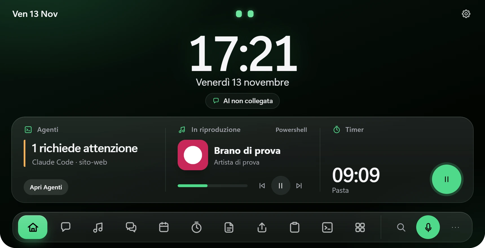 Green |
| 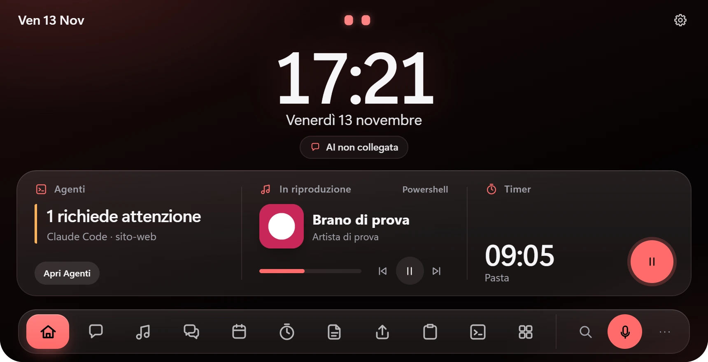 Red | 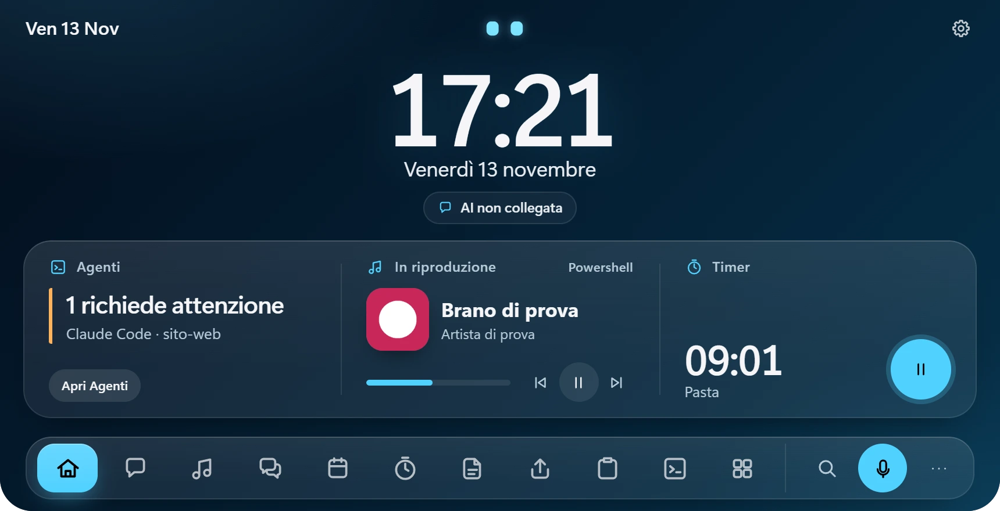 Ocean | 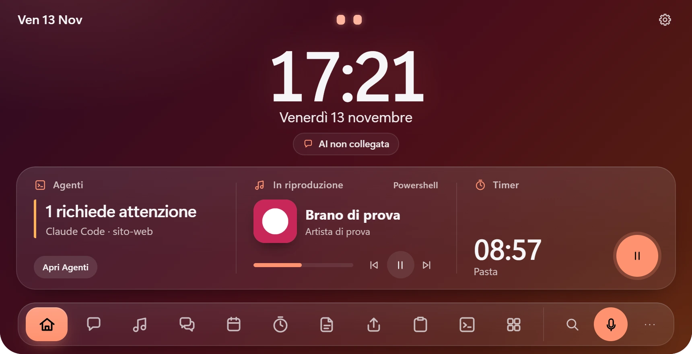 Sunset |
| 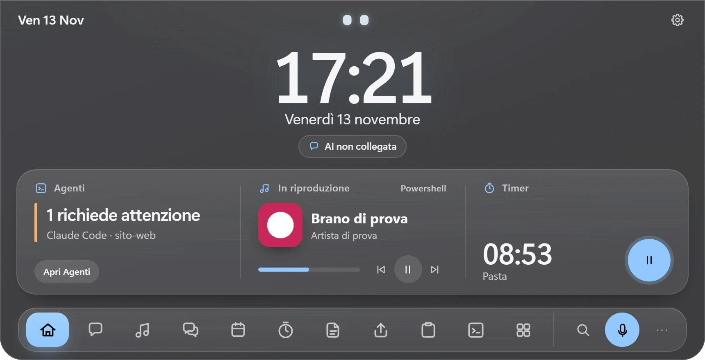 Glass (the screenshot cannot show the desktop behind it) | | |

## Features

- **V7 interface** — a wide, low panel (860 × 440) that opens in two quick steps, an icon bar at the bottom with up to nine sections of your choice plus «More», search and the microphone, and a header with only the date, the eyes and the Settings gear.
- **Home** — large clock, status chips for connected wireless devices (Bluetooth or USB receivers) and the AI, and three widgets: assistant or agents, now playing, timer.
- **AI assistant** — ChatGPT through *Sign in with ChatGPT* when the account plan permits it, or Gemini through your own Google AI Studio key. No automatic paid-API fallback. The chat is temporary and kept in memory only.
- **Local voice** — Parakeet Ultra speech-to-text and Piper Italian speech synthesis, both on the CPU. Parakeet is downloaded on request from Settings → Voice.
- **Local actions** — deterministic commands for time and dates, timers, reminders, notes, calendar, music, Windows volume, folders, devices, quiet mode, notifications and navigation. AI replies are never interpreted as commands; sensitive actions ask for confirmation.
- **Music** — Windows media sessions with cover, timeline, transport and per-player volume; can open, start and close Spotify, Apple Music or TIDAL.
- **Calendar** — read-only Google/Outlook ICS feeds with recurring events, time zones, reminders and an encrypted offline cache; the month stays visible even before a calendar is connected. Creating or editing an event opens the browser.
- **Messages** — WhatsApp Web and Telegram Web, each in its own isolated WebView2 profile, with notifications and an optional DPAPI-encrypted local history.
- **Share file** — pick a file or drag it from File Explorer, start sharing and scan the QR code with your phone on the same network. While this page is open the island stays open even if you click elsewhere, so you can drag files in.
- **Coding agents** — optional, observation-only monitoring for Claude Code and Codex through local hooks; prompt and tool contents are discarded.
- **Personalisation** — twelve themes (Dynamic Original, Blue, Violet, Green, Red, Midnight, Ocean, Aurora, Sunset, Emerald, Graphite, Glass), four compact styles, island characters, docking/floating modes, multi-monitor placement and configurable shortcuts.
- **Quick access** — Command Palette and audio centre; text-file attachments in the Chat composer.
- **Fullscreen awareness** — can hide while a fullscreen app occupies the same monitor; no overlay injection or screen capture.
- **Self-updating** — manual confirmation, minisign verification and preservation of the user profile.

## Privacy and local processing

| Data | Handling |
|---|---|
| Microphone audio | Processed locally and not written to disk. The optional wake word also runs locally. |
| Chat text | Sent only to the selected ChatGPT or Gemini provider, and only for messages that are not recognised local commands. |
| AI chat | Kept in memory only; gone when Dynamic closes or with **Nuova chat**. |
| Credentials and calendar addresses | Stored with Windows DPAPI where sensitive; never placed in screenshots or diagnostics. |
| Notes, timers and histories | Kept in the user's local profile. |
| Shared files | Read from disk in chunks while a phone downloads them; never copied or uploaded anywhere. |
| Screen and other applications | Dynamic does not capture the screen, inspect app contents or inject code. |
| Chat attachments | Only text files you pick; sent as text only when you press Send, never written to disk or logs. |
| Coding-agent hooks | Observation only; prompt and tool payloads are discarded. Dynamic never approves requests for the agent. |

### About Share file (QR)

- A small HTTP server starts **only** when you press «Avvia condivisione» and stops when you stop sharing, when the link expires (5–60 minutes) or when Dynamic closes.
- It listens only on the PC's private network address, serves one file at an unguessable 128-bit link, and accepts at most three connections.
- **The connection is plain HTTP, not encrypted.** Use it only on networks you trust (home or office), not on public Wi-Fi.
- There is no cloud relay: the phone must be on the same network. Guest networks with client isolation block it.
- The first time, Windows Firewall may ask for access: allow **Private networks**.

Third-party licence notices, voice attribution and the corresponding Piper source references are included with the installer.

## Installation and updates

1. Open the [latest release](https://github.com/JustKoal/Dynamic-releases/releases/latest).
2. Download **`Dynamic_x.y.z_x64-setup.exe`** (about 380 MB; Parakeet Ultra is a separate 550 MB download from Settings → Voice).
3. Run the installer. It installs for the current user and does not require administrator rights.
4. Follow the guided setup, or postpone it and use local features first.

**Updates.** Dynamic checks this repository's `latest.json` shortly after startup and then periodically when automatic checks are enabled. When a newer
version is available, Settings → Information shows it. Installation starts only after you choose it: the app downloads the installer, verifies its
minisign signature against the embedded public key, performs the per-user update and restarts. Settings and local data are retained — updating from
0.2.x to 0.3.0 keeps your profile, and your previous navigation bar is carried over into the larger V7 bar.

## Requirements

- Windows 11 x64. Windows 10 is not tested.
- A CPU with AVX2; local speech recognition is CPU-only.
- A microphone for voice features.
- Internet only for the selected AI provider, calendar downloads, updates and the optional Parakeet download.
- For conversational AI: a compatible ChatGPT account or a personal Gemini API key. Local commands work without either.
- For Share file: a phone on the same trusted local network.

## Known limitations

- **Share file has not yet been tried with a real phone,** and the Windows Firewall prompt has not been observed on a clean PC. Downloads were verified from the same PC.
- **The Glass theme's translucency has not been checked on screen;** Glass falls back to an opaque smoke grey when Windows transparency effects are off.
- **Codex CLI notifications do not work in 0.2.0 to 0.3.0 on Windows.** A real Codex CLI 0.163.0 session cannot launch the generated `commandWindows` (a quoting defect in the hook command); Claude Code monitoring is unaffected.
- Telegram notification reception has not been confirmed with a real account; WhatsApp group and sender details depend on what WhatsApp Web puts in its notifications.
- Human-voice accuracy, wake-word false positives, suspend/hibernate, screen readers, real-game FPS/frametime, GPU usage and a clean second PC remain unverified.
- Apple Music was not exercised for real; TIDAL releases its audio output after a few minutes of pause.
- Windows offers no public API for apps to change the default audio output: Dynamic tells you which output is in use and points to Win+Ctrl+V.
- Chat attachments accept text files only and have not been sent to a real ChatGPT or Gemini account yet.
- The installer has a valid updater minisign signature but no Authenticode certificate; SmartScreen may warn.

## Links

- [Latest release and download](https://github.com/JustKoal/Dynamic-releases/releases/latest)
- [All releases, notes and checksums](https://github.com/JustKoal/Dynamic-releases/releases)
- [Update feed (`latest.json`)](https://github.com/JustKoal/Dynamic-releases/releases/latest/download/latest.json)

---

Windows 11 x64 · Tauri 2 · Rust · React · TypeScript · Parakeet · Piper
